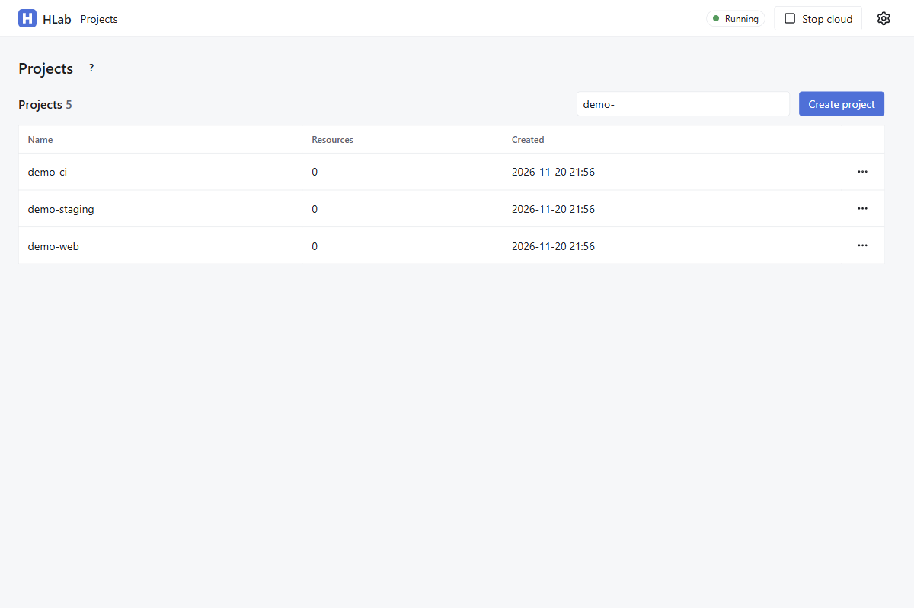
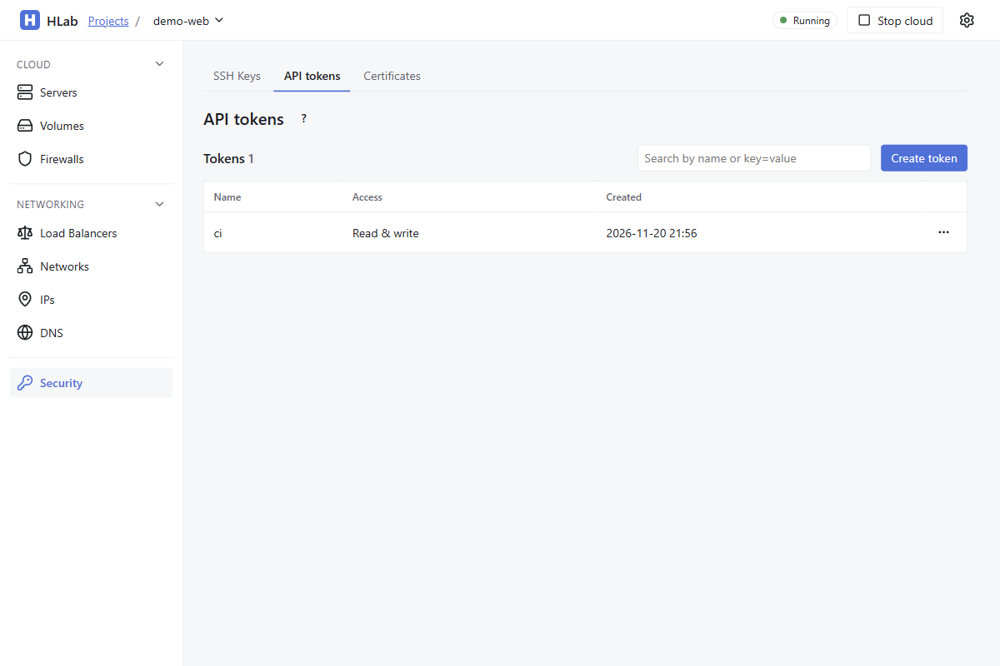

<p align="center">
  
</p>

<p align="center">
  
  
</p>

<p align="center">
  <a href="docs/guide.md">Guide</a> ·
  <a href="docs/commands.md">Commands</a> ·
  <a href="docs/configuration.md">Configuration</a> ·
  <a href="docs/deviations.md">Deviations</a> ·
  <a href="docs/development/setup.md">Development</a>
</p>

HLab is a local Hetzner Cloud on Hyper-V under Windows. Unmodified
Hetzner clients (hcloud CLI, OpenTofu provider hetznercloud/hcloud,
Ansible collection hetzner.hcloud) talk to it as if it were the real API,
and the servers they create are real Hyper-V VMs you can reach with SSH
from Windows and from WSL2. Use it to try out a Hetzner setup on your own
machine before you run it at Hetzner.

HLab offers projects and API tokens, SSH keys, servers with snapshots,
backups, rescue system and ISOs, volumes, placement groups, private
networks, primary and floating IPs, firewalls, DNS zones with reverse DNS,
load balancers and certificates. Other parts of the Hetzner API answer
`not_found`; what else differs is in [Known deviations](docs/deviations.md).
A [tray program](#the-tray-program) starts and stops the cloud and manages
projects, tokens, every resource of a project, server types and settings.

<p align="center">
  <picture>
    <source media="(prefers-color-scheme: dark)" srcset="docs/images/projects-dark.png">
    
  </picture>
  <picture>
    <source media="(prefers-color-scheme: dark)" srcset="docs/images/tokens-dark.png">
    
  </picture>
</p>

## Prerequisites

- Windows 11 Pro, Enterprise or Education (or Windows Server 2022/2025 with
  Desktop Experience), x64, with hardware virtualization on.
- Hyper-V and its PowerShell module enabled.
- For access from WSL2: WSL2 in NAT networking mode with `dnsTunneling`
  on, which are the defaults (see [WSL2](#wsl2)).
- The clients you want to use. HLab is tested with hcloud CLI v1.70.2,
  OpenTofu 1.13.9 with the provider hetznercloud/hcloud 1.70.2, and in
  WSL2 ansible-core 2.22.0 with hcloud-python 2.27.0 and the collection
  hetzner.hcloud 7.2.0:
  `uv tool install ansible-core==2.22.0 --with hcloud==2.27.0` and
  `ansible-galaxy collection install hetzner.hcloud:==7.2.0`.
- Internet access: HLab downloads system images, ISOs and packages when it
  first needs them.

## Installation

There is no installer yet. Build HLab from source and register its
service once, as described in the [developer setup](docs/development/setup.md);
the programs are then in `bin\` of your working copy, and the examples
below run from there.

## First steps

Start the cloud. The first start creates the virtual switch and the
appliance VM and takes a few minutes; wait until the status says
`running`:

```
> bin\hlab.exe cloud start
the cloud is starting
> bin\hlab.exe cloud status
state: running
version: dev
```

Create a project and a token for it. The token is printed once and cannot
be shown again:

```
> bin\hlab.exe project create demo
project demo created
> bin\hlab.exe token create --project demo --name ci
<64-character token>
```

Point hcloud at HLab with two environment variables (PowerShell):

```powershell
$env:HCLOUD_ENDPOINT = "http://api.hetzner.internal/v1"
$env:HCLOUD_TOKEN = "<the token>"
```

The OpenTofu provider and the Ansible collection read the same two
variables; see [OpenTofu and Ansible](docs/guide.md#opentofu-and-ansible).
Then use hcloud as with the real cloud:

```
> hcloud ssh-key create --name demo --public-key-from-file $HOME\.ssh\id_ed25519.pub
SSH Key 94 created
> hcloud server create --name web1 --type cx23 --location fsn1 --image ubuntu-24.04 --ssh-key demo
Waiting for create_server (server: 281) ...
Waiting for create_server (server: 281) ... done
Server 281 created
IPv4: 198.19.1.49
IPv6: 2001:db8:0:119::1
IPv6 Network: 2001:db8:0:119::/64
> ssh root@198.19.1.49
root@web1:~# uname -sr
Linux 6.8.0-147-generic
```

The server gets the CPUs, memory and disk of its server type. The first
server with an image downloads that image from its official source, so it
takes longer; later servers reuse the cached copy. `server create` returns
when the VM runs; a fresh server needs about a minute more until
cloud-init has finished and SSH accepts the key.

Clean up with `bin\hlab.exe project delete demo`, which deletes the
server and the SSH key with the project, and `bin\hlab.exe cloud stop`.

The [guide](docs/guide.md) shows every resource with hcloud and in the
window: servers, placement groups, snapshots and backups, ISOs, volumes, networks, IPs, firewalls, DNS, load balancers and
certificates, and stopping and starting the cloud.

## The tray program

```
> bin\hlab-tray.exe
```

opens the HLab window and puts the HLab icon in the notification area.
The icon shows the state of the cloud with a coloured dot; its tooltip
reads, for example, `HLab: Cloud running`. Right-click the icon for its
menu:

- the state line, for example `Cloud running`;
- **Open HLab** shows the window, as a click on the icon does;
- **Start cloud** while the cloud is stopped, **Stop cloud** while it
  runs; while it starts or stops the item is disabled and reads
  "Starting cloud…" or "Stopping cloud…";
- **Quit** ends the tray program; the cloud keeps running.

Closing the window only hides it. Starting `hlab-tray.exe` again shows
the window of the tray that already runs. The tray program does not start
with Windows.

The top bar of the window holds **HLab** (back to the project list), the
breadcrumb, the cloud state with **Start cloud** or **Stop cloud**, and
the gear **Administration**; a second click on the gear returns to the
page shown before. A banner reports a lost connection to the
service or a failed start; when the cloud refused to start because of its
state, it offers **Discard state and start**, which does what
`hlab cloud start --discard-state` does (see
[Discarding the state](docs/guide.md#discarding-the-state)) after you
confirm.

- **Projects**, the start page: the list of projects with
  **Create project**, a search field, and **Delete** in each row's menu
  (`…`). Click a project to open its console; the window opens the last
  project you used when it starts again.
- The **project console** opens on **Servers**. Its sidebar groups the
  entries like the Hetzner Cloud Console: **Cloud** with **Servers**,
  **Volumes** and **Firewalls**; **Networking** with **Load Balancers**,
  **Networks**, **IPs** and **DNS**; and, below a line, **Security**. A
  click on a group heading collapses or expands it, and the window
  remembers the collapsed groups. An entry with several views shows them
  as tabs above the page:

  | Entry | Tabs |
  |---|---|
  | Servers | Servers, Snapshots, Backups, Placement Groups |
  | IPs | Primary IPs, Floating IPs |
  | DNS | DNS Zones |
  | Security | SSH Keys, API tokens, Certificates |

  The project name in the breadcrumb switches to another project.
  - Each resource section has a list with a search field (a name, or a
    label selector such as `env=dev`), a create button that opens a form,
    and a detail page with an actions menu (`…`) and tabs such as Labels
    and Protection. Labels are entered as chips: type `key=value` (or
    just `key`) and press Enter, Space or a comma. **Snapshots** and
    **Backups** have no create form; they are made on a server's page.
    A toast follows each action and names the resource, for example
    "Network test: Delete". See
    [Servers in the window](docs/guide.md#servers-in-the-window) and the
    paragraph "In the window" under each resource of the
    [guide](docs/guide.md).
  - **Servers**: the list with **Create server** and power actions in the
    row menu, the create form, and a detail page per server with an
    actions menu (power, rebuild, change type, rename, delete) and the
    tabs Overview, Networking, Firewalls, Volumes, Backups, Snapshots,
    Rescue, ISO, Graphs, Labels and Protection.
  - **API tokens**: **Create token** asks for a name and whether the
    token is read only, and shows the token once with a copy button;
    **Revoke** is in the row menu.
- **Administration** has its own sidebar:
  - **Server Types**: the catalog and your own types, also while the
    cloud is stopped. **Add server type** adds an own type for all or
    selected locations, **Edit** and **Remove** in an own type's row menu
    change or remove it; **Update from Hetzner** asks for a Hetzner token
    in a dialog and uses it once, without storing it. See
    [Custom server types](docs/configuration.md#custom-server-types).
  - **ISOs**: the ISOs of the catalog and your own ISOs, also while the
    cloud is stopped. **Add ISO** adds an own ISO from a URL or a local
    `.iso` file; **Edit** and **Remove** are in an own ISO's row menu.
    See [Own ISOs](docs/guide.md#own-isos).
  - **Settings**: every key of `settings.toml`, the switch
    **Trust the HLab CA** and **Save CA certificate** (see
    [Trusting the HLab CA](docs/guide.md#trusting-the-hlab-ca)).
  - **Logs**: the service log as it is written, with a level filter, a
    search over all log files and **Load older lines**.

Projects and their sections need the running cloud; while it is stopped,
the project pages show "Start the cloud to manage projects" with a
**Start cloud** button. The `?` button of each page opens its help.

## WSL2

hcloud, OpenTofu and Ansible in a WSL2 distribution reach
`api.hetzner.internal` and the servers' addresses as on Windows, with the
same endpoint and token. This needs WSL2 in NAT networking mode with
`dnsTunneling` on, which are the WSL defaults. In
`%UserProfile%\.wslconfig`, section `[wsl2]`, leave `networkingMode` unset
or set it to `nat`, and leave `dnsTunneling` unset or set it to `true`.

At every `hlab cloud start`, HLab reads the `.wslconfig` of the user
logged on at the console. When it finds `networkingMode` set to
`mirrored`, `virtioproxy`, `bridged` or `none`, or `dnsTunneling=false`,
the cloud starts anyway and `hlab cloud status` shows a `problem:` line
saying what to change. Change `.wslconfig`, run `wsl --shutdown`, and stop
and start the cloud. HLab only reads the file; it does not notice when WSL
falls back to another mode on its own.

HLab enables IPv4 forwarding for the WSL adapter when the cloud starts and
restores the previous setting when it stops. It does not yet notice when
WSL recreates its adapter (after `wsl --shutdown`); stop and start the
cloud again in that case.

## Uninstallation

If you turned on trust for the HLab CA, run `bin\hlab.exe ca trust off`
first, while the cloud still runs. Then, in an administrator terminal in
the repository:

```
bin\hlabd.exe uninstall-cleanup
```

It stops and removes the service `hlab-dev`, removes the host network
settings it made (route, NAT, DNS rules, firewall rule) and deletes
`%ProgramData%\hlab-dev`. With `--keep-data` the data folder stays. The
Hyper-V VMs and the virtual switch `hlab-dev` stay; remove them in Hyper-V
Manager if you want them gone.

## More documentation

- [Guide](docs/guide.md): every resource with hcloud, OpenTofu and Ansible.
- [Command reference](docs/commands.md): every `hlab` command and flag.
- [Configuration reference](docs/configuration.md): `settings.toml`, own
  server types and the catalogs.
- [Known deviations](docs/deviations.md): what differs from Hetzner.
- [Developer guide](docs/development/setup.md): setup, build and tests,
  components, adding a resource.
